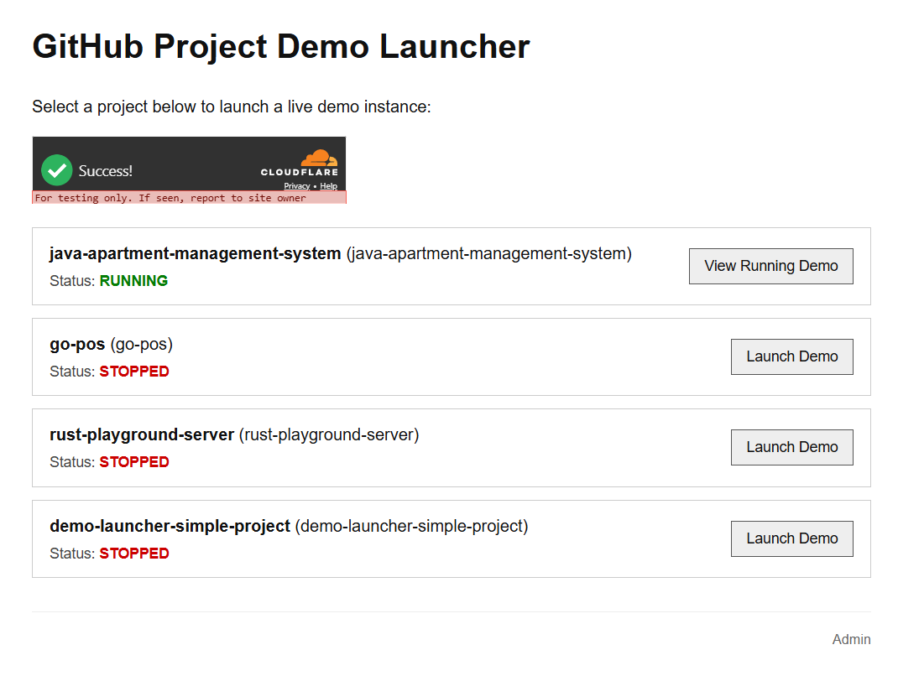
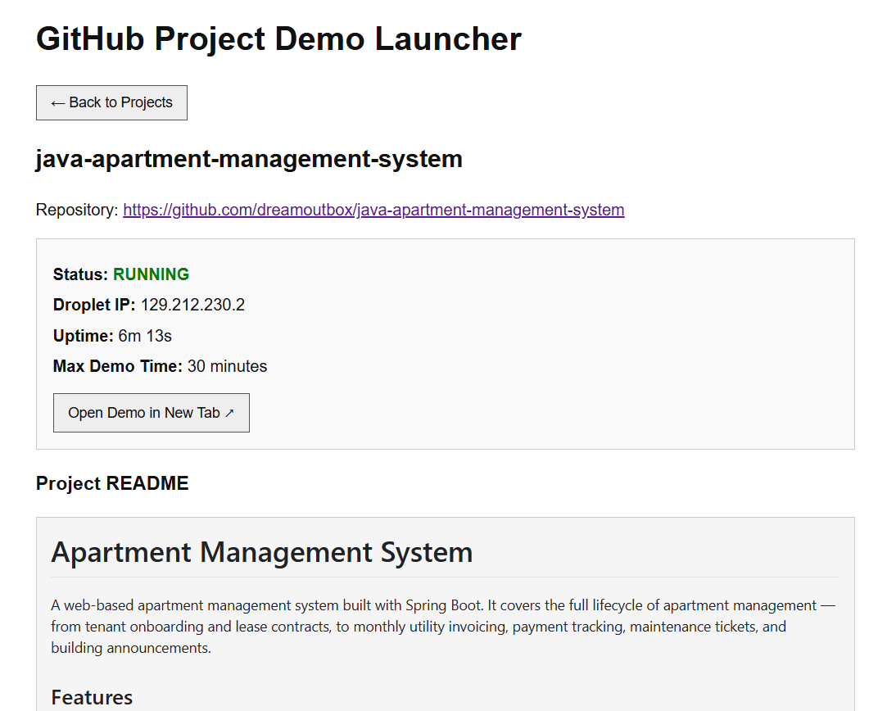
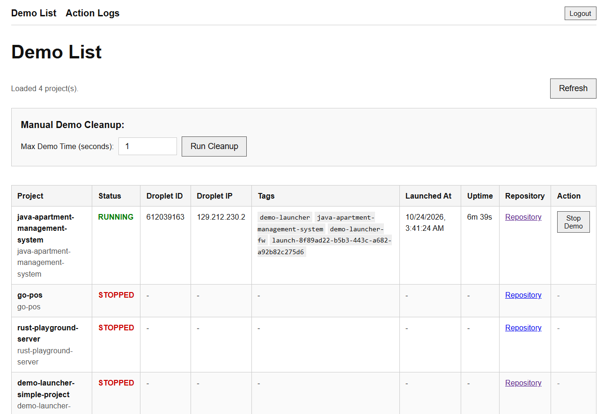
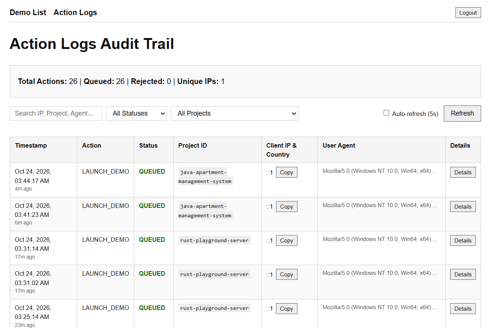

This is a Cloudflare Worker using Durable Objects. When a guest clicks on a demo they want to try on the web page, the Cloudflare Worker sends a message to the queue, and the Durable Object picks up the message to spin up a temporary DigitalOcean droplet using a PAT token.

It is secured by Cloudflare Turnstile to prevent bot spam, and admins can view audit logs for users requesting to launch demo instances.

This is almost zero-cost to run (excluding DigitalOcean costs). There is no need to keep a VPS pre-provisioned to handle user requests only to sit idle and waste money when there are no users.

The source code and setup guide are available on GitHub. You can set up your own demo launcher for any projects you want to showcase.

## Source code

[https://github.com/dreamoutbox/demo-launcher](https://github.com/dreamoutbox/demo-launcher)

